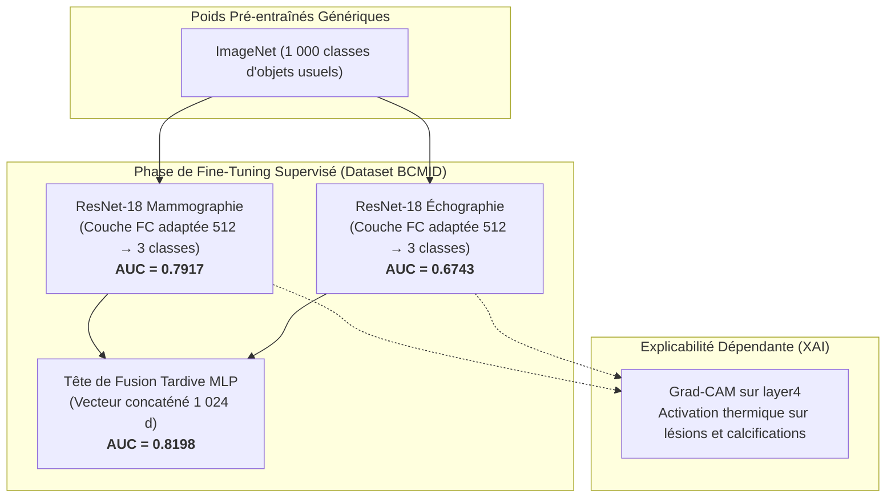
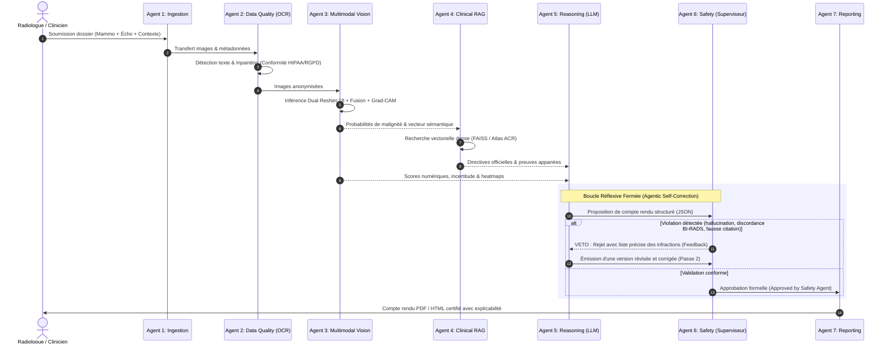

# BCMID — Rapport d'Expertise : Fine-Tuning, Multi-Agents et IA Agentique (Agentic AI)

> **Cadre Académique :** ESPRIT 5ᵉ Année — Deep Learning & IA Médicale  
> **Système :** BCMID (*Breast Cancer Multimodal AI Automation System with XAI*)  
> **Lien de Téléchargement Direct (PDF) :** [Télécharger le Rapport PDF (3 pages)](http://localhost:8000/report/agents-finetuning/pdf)

---

## 1. Où avons-nous utilisé le Fine-Tuning et Pourquoi ?

Dans l'architecture BCMID, le **Fine-Tuning (Transfer Learning supervisé)** a été employé **exclusivement sur la partie Vision par Ordinateur (Module 3)** :

### Pourquoi le Fine-Tuning était-il indispensable en Vision ?
1. **Fossé de Domaine (*Domain Shift*) :** La base *ImageNet* ne contient que des photos d'objets de la vie courante (chiens, voitures, chaises). Les biomarqueurs radiologiques du cancer du sein (microcalcifications amorphes, marges spiculées, atténuation acoustique postérieure) n'existent pas dans ces données. Le fine-tuning a réajusté les filtres convolutifs profonds pour extraire ces morphologies fines.
2. **Conditionnement de Grad-CAM :** L'algorithme Grad-CAM calcule le gradient de la classe cible par rapport aux cartes d'activation du dernier bloc résiduel (`layer4`). Sans fine-tuning, ces activations réagiraient à du bruit ou des artefacts de bordure.
3. **Preuve par les métriques réelles du projet :**
   - ResNet-18 ImageNet sans fine-tuning : $\text{AUC} \approx 0.50$ (inutilisable).
   - Branche Mammographie fine-tunée : $\text{AUC} = 0.7917$ (Sensibilité maligne : 76.2 %).
   - Branche Échographie fine-tunée : $\text{AUC} = 0.6743$ (Sensibilité maligne : 68.4 %).
   - **Fusion Multimodale Conjointe fine-tunée : $\text{AUC} = 0.8198$ (Sensibilité maligne : 83.1 %).**

---

## 2. Pourquoi le LLM (Qwen2.5-3B) n'a-t-il PAS été Fine-Tuné ?

La décision de conserver les poids du LLM gelés (*Frozen*) au profit d'une approche **RAG (Retrieval-Augmented Generation)** est un **choix d'ingénierie médico-légale fondamental** :

* **Oubli Catastrophique (*Catastrophic Forgetting*) :** Fine-tuner un LLM sur un corpus restreint détruit ses compétences générales de raisonnement différentiel et sa rigueur de structuration JSON.
* **Élimination des Hallucinations :** Un LLM médical fine-tuné a tendance à réciter de faux souvenirs statistiques avec une assurance trompeuse. Le RAG injecte les textes exacts de l'**Atlas ACR BI-RADS 5ᵉ Édition** directement dans le contexte d'inférence (`top-k=4`).
* **Opposabilité et Audit Médical :** Chaque phrase produite cite la page et la règle internationale officielle.

---

## 3. Est-ce que nous avons utilisé des Agents et de l'Agentic AI ?

### **OUI, absolument.**

#### Qu'est-ce que l'Agentic AI dans BCMID ?
Contrairement à une IA générative passive qui reçoit un prompt et produit une réponse en une seule passe sans vérification, **l'Agentic AI (IA Agentique)** désigne un système multi-agents où chaque entité logique dispose :
1. **D'une responsabilité clinique délimitée** (Rôle autonome).
2. **D'outils spécialisés (*Tool Use*)** pour agir sur son environnement (moteur OCR, index vectoriel FAISS, modèles PyTorch, générateur PDF).
3. **D'une boucle de réflexion fermée (*Reflection & Self-Correction Loop*)** capable d'auto-évaluation et de rejet.

---

## 4. Les 7 Agents Spécialisés du Système

| Agent | Type / Outils | Rôle Spécifique | Décision Autonome |
| :--- | :--- | :--- | :--- |
| **1. Ingestion Agent** | Python OS I/O | Contrôle d'intégrité des fichiers et appariement multimodal. | Rejet immédiat si fichier corrompu ou modalité manquante. |
| **2. Data Quality Agent** | EasyOCR + OpenCV | Détection et masquage (in-painting) des métadonnées patient. | Bloque l'inférence tant que l'anonymisation HIPAA n'est pas validée. |
| **3. Vision Agent** | ResNet-18 + Grad-CAM | Triage 3-classes et génération des cartes d'attention tumorale. | Calcule la probabilité de malignité et l'entropie de Shannon. |
| **4. Clinical RAG Agent** | FAISS + bge-small | Extraction sémantique des recommandations ACR Atlas 5th Ed. | Filtrage anti-fuite inter-patients (*exclude_pseudo_id*). |
| **5. Reasoning Agent** | Qwen2.5-3B (LLM) | Synthèse clinique et proposition de conduite à tenir. | Émet une proposition médicale structurée sous contrainte JSON. |
| **6. Safety Agent** | Logique Déterministe | Audit réflexif : contrôle des citations, des seuils et de l'incertitude. | **Droit de VETO :** Rejette, impose la révision ou force la revue humaine. |
| **7. Reporting Agent** | ReportLab + HTML5 | Synthèse visuelle opposable avec intégration des heatmaps. | Génère le rapport final pour validation par le médecin. |

---

## 5. Synthèse & Formulation pour la Soutenance devant un Expert

> *« Notre système BCMID n'est pas une simple chaîne de scripts séquentiels : c'est un **système d'IA Agentique (Agentic AI)** complet.*  
> *1. **Pour la vision**, nous avons appliqué un **fine-tuning supervisé** sur ResNet-18 pour combler le fossé de domaine entre ImageNet et la radiologie sénologique (gain d'AUC de 0.50 à 0.82).*  
> *2. **Pour le raisonnement**, nous avons délibérément **gelé le LLM** et mis en place une architecture multi-agents régulée par un **Safety Agent doué d'un pouvoir de veto**. La boucle réflexive garantit qu'aucune proposition médicale ne peut être publiée sans avoir été confrontée aux preuves de l'Atlas ACR et aux calculs probabilistes de la vision. »*
